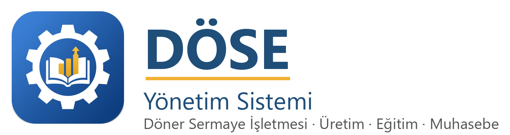

# DÖSE Yönetim

<p align="center">
  
</p>

Mesleki ve teknik okulların döner sermaye işletmesi (DÖSE) için tek uygulama. Bilgisayarda, telefonda ve tarayıcıda
aynı Flet istemcisi açılır. Bütün kayıtlar **Supabase**'tedir; okulda sunucu veya yerel veritabanı yoktur.

## Model

- **Lisans okula aittir.** Satıcı okulu açar; müdür e-posta + etkinleştirme kodu ile ilk Okul Müdürü olur.
- **Herkes kendi adıyla girer.** Roller e-posta davetiyle bağlanır; alan şefi/öğretmen yalnız kendi atölyesini görür.
- **Okullar birbirini göremez** (`okul_id` + RLS). Telefon ve masaüstü aynı kayda yazar.
- **Üstüne yazılmaz** (sürüm); **numarayı sunucu verir**; **işlem kaydı silinmez**.
- Ana ekran yasal süreleri (hazine, vergi, Bakanlık mizan/faaliyet) ve bekleyen onayları gösterir.

## Özellikler

Tanımlar, sipariş onay zinciri (özel sektör/tesis peşinat denetimi dahil), fatura (yerel kayıt; GİB gönderimi yok),
stok, yevmiye/mizan, kasa/banka (avans/virman/faturasız; banka API’si yok), parça başı, fazla çalışma, hazine payı,
yıl sonu/ÜTP, merkez parametre yayını + okul doğrulaması, maliyet/fiyat, yıllık özet + üç aylık faaliyet + Bakanlık
mizan çıktıları, resmi yazı şablonları ve denetim formu.

## Çalıştırma

```powershell
pip install -r requirements.txt
python main.py
```

İstemci: `istemci/ayar.py` veya `DOSE_SUPABASE_URL` / `DOSE_SUPABASE_ANAHTAR`.

```powershell
cd supabase; npm install; npm test; cd ..
python -m pytest tests -q
```

## Mimari

```
main.py          → masaüstü giriş
istemci/         → Flet UI (Windows / Android / web)
dose/            → çekirdek hesap, mevzuat, Excel/PDF, şablonlar
supabase/        → migrations + PGlite testleri (CLI klasör adı sabit)
tests/           → Python testleri
docs/            → kurulum, satıcı ve teknik kılavuzlar
```

| Yol | İçerik |
|---|---|
| `istemci/` | Flet istemcisi (`pyproject.toml`, APK betiği, assets) |
| `dose/` | Paylaşılan çekirdek (RPC adları `dose_*` ile uyumlu paket) |
| `supabase/` | Şema, RLS, RPC; yerelde `npm test` |
| `tests/` | Birim ve uçtan uca testler |
| `docs/` | Kılavuzlar |

[Kurulum](docs/KURULUM.md) · [Satıcı](docs/SATIS_REHBERI.md) · [Teknik](docs/TEKNIK_SERVIS_KILAVUZU.md)
